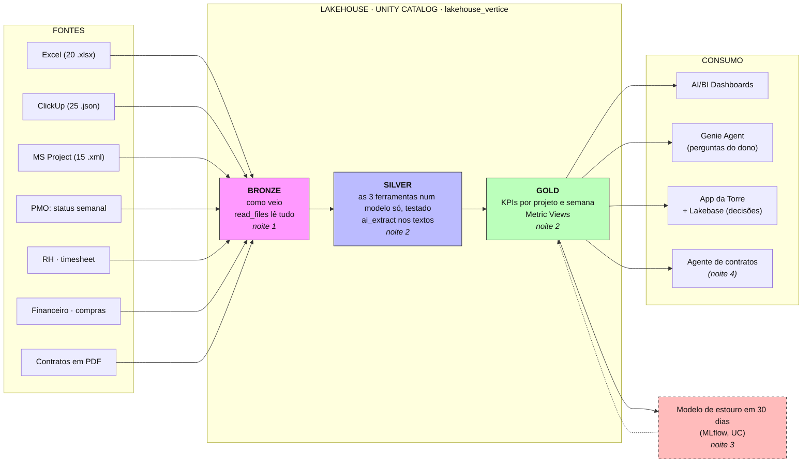

# 🔦 Projeto Farol · Imersão Databricks + Claude Code + IA

## Objetivo do manual

Apresentar as dificuldades de instalação, configuração do ambiente de desenvolvimento e das ferramentas utilizadas.
O material fornecido pela **Jornada de Dados** é super completo.

Após algumas configurações, instalações alterei os nomes: _Projeto_, _arquivos_, _chamadas das rotinas, scripts_, justamente para testar meus conhecimentos.

No final de cada tópico descrevo as diferenças (se houverem) de comandos utilizadas e o por que, sob o título: **Diferenças:**.

## Links úteis

> Plataforma de cursos - [Jornada de Dados](https://suajornadadedados.curseduca.pro/m/courses)
> Repositório oficial da imersão - [ImensaoControlTower](https://github.com/lvgalvao/ImersaoControlTower)
>
> Meu repositório - [Projeto: Farol - Vértice](https://github.com/RogerioTonini/vertice_farol)
> LinkedIn - [Rogerio Tonini](https://www.linkedin.com/in/rogerio-tonini)
>
> **Nome da solução: _FarolTorre_**

## Contexto do projeto

### 1. Desafio proposto

> Este projeto foi desenvolvido pela empresa **Jornada de Dados**, sob o título: **IMERSÃO DATABRICKS + CLAUDE CODE: MODELAGEM, DASHBOARD E IA**, no período de **19 a 22 de outubro de 2026**, com duração aproximada de **7:30 hrs**
>
> Stacks utilizadas no projeto: **Databricks Free Edition (serverless)**, **SQL**, **Python**, **Lakeflow**, **Unity Catalog**, **AI/BI**, **Genie**, **Apps**, **Lakebase**, **Claude Code**.
>
> Ferramentas utilizadas no projeto: **Databricks Free Edition (serverless)**, **Python**, **SQL**, **Claude Code** e **SUPABASE**.
>
> **Git do projeto** [ImensaoControlTower](https://github.com/lvgalvao/ImersaoControlTower)
>
> **Links das aulas**
>
> [IMERSÃO DATABRICKS + CLAUDE CODE: PIPELINE E INGESTÃO DE DADOS (AWS E API) | DIA 1](https://www.youtube.com/watch?v=4lC5t6fm2yE&pp=ygVNaU1FUlPDg08gREFUQUJSSUNLUyArIENMQVVERSBDT0RFOiBQSVBFTElORSBFIElOR0VTVMODTyBERSBEQURPUyAoQVdTIEUgQVBJKSA%3D)
>
> [IMERSÃO DATABRICKS + CLAUDE CODE: PIPELINE E INGESTÃO DE DADOS (AWS E API) | DIA 2](https://www.youtube.com/watch?v=jLUvmFgOtkk&t=862s&pp=ygVNaU1FUlPDg08gREFUQUJSSUNLUyArIENMQVVERSBDT0RFOiBQSVBFTElORSBFIElOR0VTVMODTyBERSBEQURPUyAoQVdTIEUgQVBJKSA%3D)
>
> [IMERSÃO DATABRICKS + CLAUDE CODE: PIPELINE E INGESTÃO DE DADOS (AWS E API) | DIA 3](https://www.youtube.com/watch?v=sKXrAoymLqM&pp=ygVNaU1FUlPDg08gREFUQUJSSUNLUyArIENMQVVERSBDT0RFOiBQSVBFTElORSBFIElOR0VTVMODTyBERSBEQURPUyAoQVdTIEUgQVBJKSA%3D)
>
> [IMERSÃO DATABRICKS + CLAUDE CODE: PIPELINE E INGESTÃO DE DADOS (AWS E API) | DIA 4](https://www.youtube.com/watch?v=ti_fjvwAF_8&pp=ygVNaU1FUlPDg08gREFUQUJSSUNLUyArIENMQVVERSBDT0RFOiBQSVBFTElORSBFIElOR0VTVMODTyBERSBEQURPUyAoQVdTIEUgQVBJKSA%3D)
>
> **Para o aluno:** um projeto completo de ponta a ponta no GitHub, o tipo de entrega que toda empresa que vive de projeto compra, e o pitch pronto para vender para o dono.

**Importante:** Parte desta página foi retirada ada documentação oficial para explicação do contexto.

---

Você é o **único profissional de dados da Vértice Tecnologia**, uma empresa fictícia com 520 pessoas e 60 projetos de clientes. Não tem time de dados: o analista, o engenheiro, o cientista e o engenheiro de IA são você.

No primeiro dia, o dono pergunta uma coisa simples: _quais projetos estão atrasados?_ E ninguém sabe responder, porque cada gerente controla o seu projeto numa ferramenta diferente.

---

### 2. O problema

A Vértice desenvolve e implanta sistemas para grandes clientes de varejo, financeiro, saúde, logística e indústria.
São 60 projetos, e cada gerente controla o seu do seu jeito: **20 em planilhas Excel, 25 no ClickUp e 15 no MS Project**. O PMO consolida tudo à mão, toda sexta, e o farol do status semanal está quase todo verde.

Na sua primeira semana, o dono faz quatro perguntas:

| #   | Pergunta do dono                                                | O que a Torre mede                                                               |
| --- | --------------------------------------------------------------- | -------------------------------------------------------------------------------- |
| 1   | **Quais projetos estão atrasados, e de quais clientes?**        | SPI, CPI, situação, farol calculado × farol do gerente                           |
| 2   | **Quanto esse atraso vai me custar?**                           | EAC, estouro previsto, margem projetada, atraso projetado                        |
| 3   | **Tenho gente parada enquanto outro projeto pede gente?**       | utilização por pessoa e projeto, horas ociosas, causa no status                  |
| 4   | **O que vai dar errado no próximo mês, e o que eu faço agora?** | probabilidade de estouro em 30 dias, entregas de fornecedor atrasadas, contratos |

Regra de corte: **SPI ou CPI < 0,9 = atenção · < 0,8 = crítico.**

---

### 3. Glossário de bolso

| Termo                      | Em uma frase                                                                                         |
| -------------------------- | ---------------------------------------------------------------------------------------------------- |
| **SPI**                    | quanto do trabalho planejado já foi feito. 1 = no prazo; 0,8 = 20% atrás                             |
| **CPI**                    | quanto vale o que foi feito ÷ quanto custou. Abaixo de 1 = gastando mais do que entrega              |
| **EAC / estouro**          | quanto o projeto vai custar no fim, se seguir no ritmo de hoje; o estouro é o que passa do orçamento |
| **Melancia**               | projeto verde por fora (farol do gerente) e vermelho por dentro (SPI abaixo de 0,9)                  |
| **Bronze · silver · gold** | o dado como chegou · limpo e unificado · pronto para responder ao dono                               |
| **Unity Catalog**          | o "endereço" e a portaria de todo dado: `catálogo.schema.tabela`, com dono e permissão               |
| **Volume**                 | uma pasta de arquivos (xlsx, json, xml, pdf) dentro do catálogo                                      |
| **Pipeline / job**         | o pipeline monta as tabelas; o job roda tudo em ordem, sozinho, todo dia                             |
| **Metric view**            | onde mora a fórmula do KPI, para o dashboard, o Genie e o app usarem a mesma                         |
| **Genie**                  | o chat que transforma pergunta em português em SQL sobre as suas tabelas                             |
| **Lakebase**               | um banco Postgres dentro do Databricks, para o app gravar decisões                                   |
| **Claude Code**            | o assistente de código no terminal que escreve, roda e corrige o projeto a partir dos prompts        |

---

### 4. Vantagens para o negócio

| Hoje                                                    | Com a solução (Nome: Torre)                           | Ganho                              |
| ------------------------------------------------------- | ----------------------------------------------------- | ---------------------------------- |
| PMO consolida Excel, ClickUp e Project à mão toda sexta | as 3 ferramentas num modelo só, atualizado todo dia   | dias de consolidação viram zero    |
| O farol do gerente decide o que o dono vê               | farol calculado pelo número (SPI)                     | o projeto "melancia" aparece antes |
| Escopo cresce sem aditivo e ninguém cobra o cliente     | alerta quando o CPI começa a cair                     | margem recuperada                  |
| SRE parado num projeto, faltando em outro               | ociosidade por pessoa e projeto, cruzada com o status | realocar em vez de contratar       |
| Decisão de realocação por WhatsApp e e-mail             | aprovação no app, gravada com usuário e horário       | decisão rastreável e auditável     |

Medido no dado da Vértice no final do projeto:

| O que a Torre mostra                      | Valor                                                                                     |
| ----------------------------------------- | ----------------------------------------------------------------------------------------- |
| Projetos em risco · críticos              | **17 de 41 · 7**, espalhados nas três ferramentas                                         |
| Estouro previsto se nada mudar            | **R$ 6,47 mi**                                                                            |
| Farol verde com SPI abaixo de 0,9         | **4 projetos** (32 faróis verdes; pelo número, 24 projetos ok)                            |
| Gente parada                              | **2 SREs seniores a ~5%** no PRJ-007, enquanto o PRJ-011 pede SRE há 12 semanas           |
| Antecedência do modelo de estouro         | **9 de 10** estouros avisados, em média **41 dias** antes (AUC 0,92; a regra atual: 0,50) |
| Genie em português                        | **20/20** (portfólio) e **10/10** (contratos) no benchmark                                |
| Multa cobrável da CodeForge pelo contrato | **R$ 1,12 mi** (0,5% ao dia, teto de 10%)                                                 |
| Entregas de fornecedor em atraso          | **5** (todas da CodeForge)                                                                |
| ROI do pitch (premissas explícitas)       | **≈ R$ 3,0 mi** no ano 1 contra R$ 0,4 mi de custo                                        |

---

### 5. Arquitetura



Os KPIs são definidos **uma vez** (Metric Views no Unity Catalog) e reusados no dashboard, no Genie, no app e no agente.

**Importante:** O texto dos tópicos de 1 a 5 foram copiados para contextualizar o projeto.

---

### 6. Configuração do meu setup

| Ferramenta            | Versão                            |
| --------------------- | --------------------------------- |
| Sistema operacional   | Windows 10, build 10.0.19045.7807 |
| Git Bash              | git version 2.55.0.windows.5      |
| Antigravity IDE       | v2.6.0                            |
| Python (amb. global)  | 3.11.9                            |
| Python (amb. virtual) | 3.12.10                           |
| Claude Code           | v2.1.312                          |
| Databricks CLI        | v1.22.1                           |

**Importante:** Para quem não conhece de infra estrutura e SOs, as atualizações de hardware/software impactam diretamente no funcionamento das ferramentas.

---

### 7. Configurando o ambiente

**7.1.** Fiz uma mescla dos ensinamentos das aulas da **Jornada de Dados - Aula 3 da Imersão** e do **Mateus Kasuya**, da live mensal da [Jornada de Dados](https://suajornadadedados.curseduca.pro/m/courses) do **Quem sabe faz ao vivo** realizada Julho/2026 [Databricks + IA: O Workflow Completo de Desenvolvimento com Claude Code (DABs , MCP, AI Dev Kit)](https://www.youtube.com/watch?v=0l-DZkniRSg&t=1772s), para instalar/configurar o **Databricks**, conexão/criação do repositório no **GitHub** e configução do **Antigravity**.

**7.2.** Copiei para dentro do projeto todos os arquivos markdown, querys e scripts em python.

**Motivo:** Rodar sem dependências de repositórios, ferramentas externas, e o mais importante, aprendizado ao criar um ambiente independente.

---

### 8. Configuração do ambiente de desenvolvimento

**Importante:**

**a-)** As etapas de 2 a 5 foram executadas no **_Powershell_**, devido a incompatibilidades do **Windows** e **Git Bash**.

**Motivo:**
Ao executar o comando de inicialização de um projeto de **_Databricks_** no Git Bash recebo a mensagem de erro: `Error: prompting is not supported. Please specify the path, name or URL of the template to use`.

O terminal do Git Bash (Mintty) não implementa nativamente um TTY interativo para a linguagem em que a CLI do Databricks é compilada. Quando a CLI detecta que a entrada padrão não é interativa, ela aborta o assistente e exige que os valores sejam informados sem dependência do teclado.

O motivo de gerar com o nome padrão my_project ao informar apenas o template (como databricks bundle init default-python) é que a CLI utiliza um arquivo de arquivo de valores padrão (databricks_template_schema.json) quando nenhuma resposta customizada é fornecida.

_Referência_: [Create a custom bundle template](https://docs.databricks.com/gcp/en/dev-tools/bundles/template-tutorial)

**$^*$** Informação fornecida pelo **Gemini** (Outubro/2026)

**b-)** As etapas 1 e 2 só devem ser executadas caso você não tenha nenhuma _**IDE**_ ou o _**Databricks CLI**_ instalados.

---

**8.1.** Instalação/configuração da(s) ferramenta(s) necessária(s) para realização do projeto: [Antigravity IDE](https://antigravity.google/product/antigravity-ide/), [Databricks CLI](https://docs.databricks.com/aws/en/dev-tools/cli/install).

**8.2.** Instalação do Databricks CLI.

```powershell
PS D:\Git-Projetos> winget install DatabricksCLI
```

**8.3.** Verificando se foi instalado corretamente. O comando é o mesmo tanto para **Powershell** quanto **Git Bash**

```powershell
PS D:\Git-Projetos> databricks --version
```

**Saída:** Deverá ser apresentado a versão. No meu caso: `Databricks CLI v1.22.1`

**8.4.** Inicializar um novo projeto Databricks local

```powershell
PS D:\Git-Projetos> databricks bundle init
Welcome to the default Python template for Declarative Automation Bundles!

Answer the following questions to customize your project.
You can always change your configuration in the databricks.yml file later.

Note that https://dbc-068fb8ed-9845.cloud.databricks.com is used for initialization.
(For information on how to change your profile, see https://docs.databricks.com/dev-tools/cli/profiles.html.)

Unique name for this project [my_project]: vertice_farol
Include a job that runs a notebook: no
Include an ETL pipeline: no
Include a sample Python package that builds into a wheel file: no
Use serverless compute: yes
Default catalog for any tables created by this project [workspace]:
Use a personal schema for each user working on this project
(this is recommended, your personal schema will be 'workspace.<usuario>'): no, I will customize the schema configuration later in databric

✨ Your new project has been created in the 'vertice_farol' directory!

To get started, refer to the project README.md file and the documentation at https://docs.databricks.com/dev-tools/bundles/index.html.
```

**8.5.** Autenticar no Databricks

```powershell
PS D:\Git-Projetos> databricks auth login
Search: █
Select a profile
  ▸ DEFAULT [default] (account: f06cd2b8-6224-4fe8-b608-367d9ebecb06)
    + Create a new profile
    → Enter a host URL manually
```

**8.6.** Criação do repositório local e remoto

A partir desta etapa, executei pelo **_Git Bash_**.

```bash
/d/Git-Projetos
$ gh repo create
? What would you like to do? Create a new repository on github.com from a template repository
? Repository name vertice_farol
? Repository owner **Se houver mais de um usuário, selecione o que desejar**
? Description Jornada de Dados - Imersão Databricks + Claude Code + IA
? Visibility Public
? Would you like to add a README file? No
? Would you like to add a .gitignore? No
? Would you like to add a license? No
? This will create "vertice_farol" as a public repository on github.com. Continue? Yes
✓ Created repository RogerioTonini/vertice_farol on github.com
  https://github.com/RogerioTonini/vertice_farol
? Clone the new repository locally? Yes
```

**8.7.** Instalação e configuração do ambiente virtual

```bash
$ uv venv 3.12.10  # Databricks trabalha melhor com a versão 3.12
$ uv venv --seed   # Instala todos os pacotes do Databricks
$ uv sync          # Faz o download de todas as bibliotecas do python necessárias
```

**8.8.** Realizar o COMMIT / PUSH inicial

Utilizei o script scripts/support/commits_iniciais.sh para este processo.

**8.9.** Instalação das skills

```bash
$ databricks aitools install --agents claude-code --scope project --skills-only --experimental
```

### 9. Engenharia de Dados com Claude Code

**9.1.** Configurações iniciais

```bash
# Comando para listar os jobs referentes ao projeto
databricks jobs list --profile DEFAULT                                   # copie o id do job "Ingestão"

# Comando para gerar os arquivos:
# 1. src/02_ingestao_boto3_gabarito.py
# 2. File successfully saved to src/01_ingestao_api.py
#
databricks bundle generate job --existing-job-id <id> --profile DEFAULT
```

**9.2.** Gerando o arquivo que contém a chave de acesso e senha do S3

> **Importante:** Gerei este arquivo a partir do script em [Noite 3 · Engenheiro de Dados com Claude Code | Imersão Jornada de Dados](https://github.com/lvgalvao/ImersaoControlTower/tree/main/aulas/aula-03-modelagem-claude-code), item: **1 · O bundle, à mão, com a CLI (5 min, sem Claude Code)**.

```bash
$ python scripts/python/extrair_chaves_s3.py
```

**9.3.** Validar se a configuração do seu bundle está correta antes de fazer o deploy

```bash
$ databricks bundle validate --profile DEFAULT

Name: vertice_farol
Target: dev
Workspace:
  Host: https://dbc-068fb8ed-9845.cloud.databricks.com
  User: <endereco_e-mail>
  Path: /Workspace/Users/<endereco_e-mail>/.bundle/vertice_farol/dev

Validation OK!
Workspace:
  Host: https://dbc-068fb8ed-9845.cloud.databricks.com
  User: <endereco_e-mail>
  Path: /Workspace/Users/<endereco_e-mail>/.bundle/vertice_farol/dev
```

**9.4.** Publica o bundle no workspace do Databricks: envia o código e cria ou atualiza os recursos definidos nos YAMLs. Diferente do _validate_, **ele altera o workspace**.

```bash
$ databricks bundle deploy --profile DEFAULT
```

> **Importante:** Ele _**Não executa nada**_. Ele só deixa os jobs e pipelines prontos no workspace. Para rodar, use:
>
> ```bash
> $ databricks bundle run <nome_do_job> --profile DEFAULT
> ```

**9.5.** Criação / Cópia de arquivos

**a-)** Copiar o arquivo [bundle-na-mao.md](https://github.com/lvgalvao/ImersaoControlTower/blob/main/aulas/aula-03-modelagem-claude-code/claude-code/prd/bundle-na-mao.md) para a pasta _**llm/prd/**_.

**b-)** copiar o arquivo [CLAUDE.md](https://github.com/lvgalvao/ImersaoControlTower/blob/main/aulas/aula-03-modelagem-claude-code/claude-code/prd/CLAUDE.md) para a pasta _**llm/templates/prd**_.


### 10. Árvore de pastas (diretórios)

```
vertice_farol
├── 📁 .claude
├── 📁 .databricks
├── 📁 .git
│   └── 📁 hooks
│       └── 📄 commit-msg                     # padrão dos commits
├── 📁 .vscode
│   ├── ⚙️ extensions.json
│   ├── ⚙️ launch.json
│   └── ⚙️ settings.json
├── 📁 llm
│   ├── 📁 ocorrencias                        # armazena os arquivos com os erros/ocorrências em cada prompt rodado
│   │   └── 📝 prompt_01-ocorrencias.md
│   ├── 📁 prd
│   │   └── 📝 bundle-na-mao.md
│   ├── 📁 template
│   │   └── 📁 prd
│   │       └── 📝 CLAUDE.md
│   ├── 📝 prompt_01.md
│   ├── 📝 prompt_02.md
│   ├── 📝 prompt_03.md
│   └── 📝 prompt_04.md
├── 📁 resources
├── 📁 scripts
│   ├── 📁 aulas
│   │    ├── 📁 01
│   │    ├── 📁 02
|   │    ├── 📁 03
|   │    └── 📁 04
│   ├── 📁 prd
│   │   └── 🐍 extrair_chaves_s3.py
├── 📁 tests
│   ├── 📁 log
│   ├── 🐍 __init__.py
│   ├── 🐍 apoio.py
│   ├── 🐍 conftest.py
│   ├── 🐍 test_extrair_chaves_s3.py
│   └── 🐍 test_run_sql.py
├── ⚙️ .gitattributes
├── ⚙️ .gitignore
├── 📝 README.md
└── 📄 commits_iniciais.sh
├── 📝 CLAUDE.md
├── ⚙️ databricks.yml
├── ⚙️ pyproject.toml
└── 📄 uv.lock
```

```bash
git clone https://github.com/lvgalvao/ImersaoControlTower.git && cd ImersaoControlTower

# CLI do Databricks (>= 0.250) e login: cria o profile e salva a credencial
brew install databricks/tap/databricks        # ou: curl -fsSL https://raw.githubusercontent.com/databricks/setup-cli/main/install.sh | sh
databricks auth login --profile imersao        # escolha um nome e use SEMPRE --profile

# Claude Code
npm install -g @anthropic-ai/claude-code
claude                                         # na raiz do repositório
```

As **skills oficiais do Databricks** para o Claude Code já vêm no repositório (`.claude/skills/`). Para atualizar:
`databricks aitools update`.

Os prompts de cada noite, na ordem e prontos para colar: [`PROMPTS.md`](PROMPTS.md).

---

## 🗄️ O dataset

Gerado por [`material/gerar_dataset.py`](material/gerar_dataset.py): só biblioteca padrão do Python, **seed fixa 42**,
cerca de 7 MB, em menos de 1 segundo. O "hoje" do dataset é **16/10/2026**. Todo aluno gera exatamente os mesmos bytes.

```bash
python3 material/gerar_dataset.py --saida ./dados --seed 42
python3 material/validar_padroes.py --dados ./dados      # junta as 3 ferramentas e confere os 5 padrões
```

| Sistema        | O que vem                                              |        Linhas |
| -------------- | ------------------------------------------------------ | ------------: |
| PMO            | `projetos` · `status_semanal` (texto livre e farol)    |    60 · 3.911 |
| Excel          | 20 planilhas `.xlsx`, uma por projeto                  |         1.663 |
| ClickUp        | 25 exports `.json` da API                              | 2.119 tarefas |
| MS Project     | 15 arquivos `.xml`                                     | 1.260 tarefas |
| RH e timesheet | `colaboradores` · `apontamentos`                       |  523 · 30.883 |
| Financeiro     | `custos`                                               |        23.640 |
| Compras        | `entregas_fornecedor`                                  |           640 |
| Documentos     | contratos de fornecedor e SaaS (PDF, lidos na noite 4) |             8 |

**O dado é simulado, não sorteado:** cada projeto avança semana a semana. Freeze, falta de SRE e squad com
rotatividade atrasam; cada avanço consome horas e gera custo. Por isso SPI, CPI e ociosidade saem
coerentes entre si. **Padrões embutidos:**

1. 8 projetos com CPI caindo a partir do 6º mês (escopo cresce sem aditivo);
2. o change freeze da Black Friday (01/11 a 10/01) trava os 3 projetos de e-commerce;
3. a consultoria CodeForge entrega com prazo 41% acima do prometido, e aparece escrita de 4 jeitos;
4. dois SREs seniores ociosos num projeto que ainda está no desenho, enquanto o status de outro pede SRE toda semana;
5. dois squads com rotatividade alta e os piores SPI da carteira.

**A sujeira é proposital** e é o conteúdo da noite 2: cada ferramenta com seu formato de data e de percentual,
linha de TOTAL na planilha, tarefas-resumo no Project, status escrito de 12 jeitos no ClickUp, ferramenta escrita
de 8 jeitos no PMO, vírgula decimal, estorno negativo, pessoa duplicada no RH e status vazio. Não "conserte" o gerador.

---

## 📁 Estrutura

```
aulas/
├── aula-01-analista-sql/          navegador: catálogo, bronze das 3 ferramentas, 6 exemplos SQL, dashboard, Genie sem curadoria
├── aula-02-python-engenheiro/    notebooks: aquecimento de Python, data lake (boto3) → raw → bronze, API, job
├── aula-03-modelagem-claude-code/ Claude Code: bundle, silver, gold, testes, metric view
└── aula-04-produtos-de-dados-ia/  Claude Code: IA no texto, contratos, dashboard + Genie, app da Torre, pitch
material/
├── gerar_dataset.py           o gerador (seed 42)
├── validar_padroes.py         o gabarito: junta as 3 ferramentas e confere a história
├── xlsx_simples.py            escreve e lê .xlsx sem dependência
├── pdf_simples.py             escreve os PDFs sem dependência
└── PRD-torre-de-controle.md   a especificação da imersão
scripts/
├── run_sql.py                 roda um .sql no warehouse, statement por statement (API de statements)
├── genie.py                   publica um Genie a partir de JSON, pergunta e roda benchmark
├── gerar_notebooks.py         .sql dos exemplos → notebooks resolvidos e em branco
├── gerar_slides.py            fragmento de slides → apresentação HTML no visual da Jornada
└── gerar_prompts.py           monta o PROMPTS.md a partir dos prompts de cada noite
slides/                        as apresentações de cada noite (abra o .html no navegador)
.claude/skills/                as skills oficiais do Databricks para o Claude Code
```

---

## ✅ Testes

| O que                              | Comando                                                                                                                                                                                                                                                                   | Esperado                                  |
| ---------------------------------- | ------------------------------------------------------------------------------------------------------------------------------------------------------------------------------------------------------------------------------------------------------------------------- | ----------------------------------------- |
| Dataset reproduzível               | gerar duas vezes e comparar o sha256 que o validador imprime                                                                                                                                                                                                              | idênticos                                 |
| Padrões da história                | `python3 material/validar_padroes.py --dados ./dados`                                                                                                                                                                                                                     | `TODOS OS PADRÕES OK`                     |
| Noite 1 no workspace               | `python3 scripts/run_sql.py aulas/aula-01-analista-sql/99-verificacao.sql --profile P`                                                                                                                                                                                    | 22 × `ok`                                 |
| Genie da noite 1                   | `python3 scripts/genie.py perguntar "Farol · Noite 1 (bronze, sem curadoria)" "Quanto esse atraso vai me custar?" --profile P`                                                                                                                                            | resposta errada, de propósito             |
| Job completo (noites 2 e 3)        | `cd aulas/aula-03-modelagem-claude-code/claude-code/vertice && databricks bundle deploy --profile P && databricks bundle run vertice_farol --profile P`                                                                                                                   | 8 tarefas verdes, ~4 a 5 min              |
| Noite 2                            | `python3 scripts/run_sql.py aulas/aula-03-modelagem-claude-code/claude-code/prd/99-verificacao.sql --profile P`                                                                                                                                                           | 20 × `ok`                                 |
| Genie da noite 4                   | `python3 scripts/genie.py benchmark "Farol · Diretoria" aulas/aula-04-produtos-de-dados-ia/prd/genie-benchmark-diretoria.json --profile P`                                                                                                                                | 20/20 (18/10)                             |
| Noite 4 (modelo, metric view, app) | `python3 scripts/run_sql.py aulas/aula-04-produtos-de-dados-ia/99-verificacao.sql --profile P`                                                                                                                                                                            | 23 × `ok`                                 |
| Bônus: contratos                   | `python3 scripts/run_sql.py aulas/aula-04-produtos-de-dados-ia/bonus/99-verificacao-contratos.sql --profile P` e `python3 scripts/genie.py benchmark "Farol · Diretoria + Contratos" aulas/aula-04-produtos-de-dados-ia/bonus/genie-benchmark-contratos.json --profile P` | 11 × `ok` · 10/10                         |
| App + Lakebase                     | `cd aulas/aula-04-produtos-de-dados-ia/torre-app && npm test` e `python3 scripts/ver_decisoes.py`                                                                                                                                                                         | 5 testes; a aprovação aparece no Postgres |

---

## 🧪 O que funciona no Free Edition (testado em 18/10/2026)

| Recurso                                           | Status                                                                 | Como usamos                                                                |
| ------------------------------------------------- | ---------------------------------------------------------------------- | -------------------------------------------------------------------------- |
| Unity Catalog, volumes, SQL warehouse serverless  | ✅                                                                     | `CREATE CATALOG` via SQL (a API recusa no Free Edition)                    |
| `read_files` com Excel, JSON e XML                | ✅                                                                     | as 3 ferramentas entram na bronze sem conversão                            |
| Notebook serverless com internet                  | ✅                                                                     | o `00-carregar-dados` roda o gerador dentro do workspace                   |
| `ai_extract`, `ai_classify`, `ai_query`           | ✅                                                                     | causa do atraso a partir do texto do status semanal                        |
| Metric Views                                      | ✅                                                                     | só pela API de statements: o `aitools query` achata a indentação do YAML   |
| AI/BI Dashboards, Genie Agents (com modo Agent)   | ✅                                                                     | dashboard como JSON e Genie como JSON                                      |
| Databricks Apps                                   | ✅                                                                     | app da Torre (noite 4)                                                     |
| **Lakebase** (Postgres)                           | ✅ **novo**: em agosto não existia                                     | decisões gravadas pelo app                                                 |
| `ai_parse_document` em PDF                        | ✅                                                                     | os contratos viram tabela                                                  |
| Lakeflow Declarative Pipelines (SQL) com `EXPECT` | ✅                                                                     | silver e gold                                                              |
| Registro de modelo no Unity Catalog               | ⚠️ falha com o MLflow do serverless (`s3:PutObject ... explicit deny`) | `%pip install -U "mlflow-skinny[databricks]>=2.21,<3"` + `restartPython()` |
| Knowledge Assistant e Supervisor Agent            | ❌ "legacy", não cria mais                                             | agente de contratos com `ai_parse_document` + Genie                        |
| Databricks Apps                                   | ⚠️ no máximo 3 apps por workspace                                      | libere um antes do deploy da noite 4                                       |
| Endpoint de modelo próprio (Model Serving)        | ❌ só modelos de base                                                  | o score de estouro roda em lote e grava na gold                            |

---

## 🔑 Convenções

- Catálogo **`lakehouse_vertice`**, schemas `bronze` / `silver` / `gold`, volume `bronze.raw`.
- Tabelas e colunas em snake_case e português.
- "Hoje" é sempre `DATE'2026-10-16'`, nunca `current_date()`.
- Sempre `--profile` nos comandos do Databricks.
- A bronze guarda o dado **como veio**. Limpeza e integração são na silver.

---

Elaboração:
[Jornada de Dados](https://suajornadadedados.com.br) - Dados e empresas fictícios.

[Ambiente Windows](https://www.github.com/RogerioTonini/vertice_farol)
